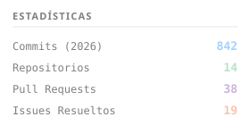
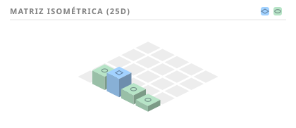
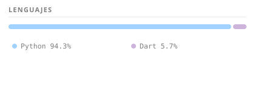

<table width="100%" cellpadding="16" cellspacing="0">
  <!-- FILA 1: CABECERA — Identidad + Redes (izq) | CTA Proyectos (der) -->
  <tr>
    <td width="70%" align="center" valign="middle">
      <h1>Edwin Quishpi Quinto</h1>
      

        
        &nbsp;
        
        &nbsp;
        
        &nbsp;
        
        &nbsp;
        
        <!-- Pendientes / Comentadas (descomenta y cambia el placeholder cuando tengas el enlace) -->
        <!-- &nbsp;&nbsp;&nbsp;  -->
        <!-- &nbsp;&nbsp;&nbsp;  -->
        <!-- &nbsp;&nbsp;&nbsp;  -->
        <!-- &nbsp;&nbsp;&nbsp;  -->
        <!-- &nbsp;&nbsp;&nbsp;  -->
        <!-- &nbsp;&nbsp;&nbsp;  -->
        <!-- &nbsp;&nbsp;&nbsp;  -->
        <!-- &nbsp;&nbsp;&nbsp;  -->
        <!-- &nbsp;&nbsp;&nbsp;  -->
        <!-- &nbsp;&nbsp;&nbsp;  -->
        <!-- &nbsp;&nbsp;&nbsp;  -->
        <!-- &nbsp;&nbsp;&nbsp;  -->
      

    </td>
    <td width="30%" align="center" valign="middle">
      
       
      
    </td>
  </tr>

  <!-- FILA 2: MÉTRICAS EN VIVO (RACHA Y ESTADÍSTICAS REALES) -->
  <tr>
    <td colspan="2" width="860" align="center" valign="middle">
      

              
              
      

    </td>
  </tr>

  <!-- FILA 3: ECOSISTEMA -->
  <tr>
    <td width="70%" align="center" valign="middle">
      
      

        <!-- Lenguajes -->
        
        
        
        
        
      

      

        <!-- Frameworks y datos -->
        
        
        
        
        
        
      

      

        <!-- Bases de datos -->
        
        
        
        
      

      

        <!-- Cloud y entorno -->
        
        
        
        
        
      

      

        <!-- IDE y diseño -->
        
        
        
        
        
        
        
        
      

    </td>
    <td width="30%" align="center" valign="middle">
      
        
      
    </td>
  </tr>

  <!-- FILA 4: CIERRE (MAPA DE CONTRIBUCIONES PROPIO Y ONDA CAMALEÓN) -->
  <tr>
    <td colspan="2" width="860" align="center" valign="middle">
      
        
      
    </td>
  </tr>
</table>

<!-- PIE: EASTER EGG MUSICAL (SPOTIFY + ECUALIZADOR TORNASOL) -->

  
♪

  

    <a href="https://open.spotify.com/intl-es/artist/67BdlNDvFCa6aRWlcrlWUy" target="_blank" rel="noopener noreferrer" title="Spotify Artist">
      
      &nbsp;
      
    </a>
  

