<table width="100%" cellpadding="10" cellspacing="0">
  <!-- ROW 1: HEADER — Identity + Socials (70%) | Codebars + CTA (30%) -->
  <tr>
    <td width="70%" align="center" valign="middle">
      <h3>Edwin Quishpi Quinto</h3>
      

        <b>Software Engineering Student · Developer · Technology Enthusiast</b>
      

      

        
          <em>Designing and building software systems through engineering principles, 
          experimentation, and continuous learning.</em>
        
      

      

        
        &nbsp;
        
        &nbsp;
        
        &nbsp;
        
        &nbsp;
        
      

    </td>
    <td width="30%" align="center" valign="middle">
      
       
      
    </td>
  </tr>

  <!-- ROW 2: AREAS OF INTEREST -->
  <tr>
    <td colspan="2" width="100%" align="center" valign="middle">
      
<b>AREAS OF INTEREST</b>

      <table width="100%" cellpadding="6" cellspacing="0">
        <tr>
          <td width="33.33%" align="left" valign="top">
            

              <b>Software Engineering</b> 
              <em>Architecture, design patterns and software quality.</em>
            

            

              <b>Mobile Development</b> 
              <em>Android, Kotlin and cross-platform applications.</em>
            

          </td>
          <td width="33.33%" align="left" valign="top">
            

              <b>Backend &amp; Distributed Systems</b> 
              <em>APIs, databases and distributed architectures.</em>
            

            

              <b>Audio Engineering</b> 
              <em>Digital signal processing and audio compression.</em>
            

          </td>
          <td width="33.33%" align="left" valign="top">
            

              <b>Systems Programming</b> 
              <em>C++, data structures, memory management and performance.</em>
            

            

              <b>Research &amp; Development</b> 
              <em>Technical experimentation and prototyping.</em>
            

          </td>
        </tr>
      </table>
    </td>
  </tr>

  <!-- ROW 3: LIVE METRICS (68% / 32% — 1:1 SVG SCALE) -->
  <tr>
    <td colspan="2" width="100%" align="center" valign="middle">
      <table width="100%" cellpadding="4" cellspacing="0">
        <tr>
          <td width="68%" align="center" valign="middle">
            
          </td>
          <td width="32%" align="center" valign="middle">
            
          </td>
        </tr>
      </table>
    </td>
  </tr>

  <!-- ROW 4: ECOSYSTEM (70% / 30% — 1:1 SVG SCALE) -->
  <tr>
    <td width="70%" align="center" valign="middle">
      
      

        <!-- Languages -->
        
        
        
        
        
      

      

        <!-- Frameworks & Runtime -->
        
        
        
        
        
        
      

      

        <!-- Databases & ORM -->
        
        
        
        
      

      

        <!-- Cloud & DevOps -->
        
        
        
        
        
      

      

        <!-- IDEs & Audio/Design -->
        
        
        
        
        
        
        
        
      

    </td>
    <td width="30%" align="center" valign="middle">
      
        
      
    </td>
  </tr>

  <!-- ROW 5: FOOTER (CONTRIBUTION GRAPH & WAVE) -->
  <tr>
    <td colspan="2" width="100%" align="center" valign="middle">
      
        
      
    </td>
  </tr>
</table>

<!-- FOOTER EASTER EGG: SPOTIFY + WAVEFORM -->

  
♪

  

    <a href="https://open.spotify.com/intl-es/artist/67BdlNDvFCa6aRWlcrlWUy" title="Spotify Artist">
      
      &nbsp;
      
    </a>
  

