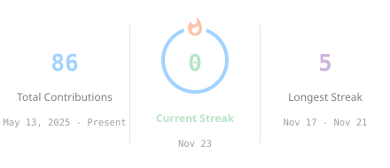

<table width="100%" cellpadding="16" cellspacing="0">
  <!-- FILA 1: CABECERA (IZQ: IDENTIDAD Y REDES | DER: CÓDIGO Y PROYECTOS) -->
  <tr>
    <td width="72%" align="center" valign="middle">
      <h1>Edwin Quishpi Quinto</h1>
       
      

        <!-- Activas -->
         &nbsp;&nbsp;&nbsp;
         &nbsp;&nbsp;&nbsp;
         &nbsp;&nbsp;&nbsp;
         &nbsp;&nbsp;&nbsp;
              
        <!-- Pendientes / Comentadas (descomenta y cambia el placeholder cuando tengas el enlace) -->
        <!-- &nbsp;&nbsp;&nbsp;  -->
  <!-- &nbsp;&nbsp;&nbsp;  -->
        <!-- &nbsp;&nbsp;&nbsp;  -->
        <!-- &nbsp;&nbsp;&nbsp;  -->
        <!-- &nbsp;&nbsp;&nbsp;  -->
        <!-- &nbsp;&nbsp;&nbsp;  -->
        <!-- &nbsp;&nbsp;&nbsp;  -->
        <!-- &nbsp;&nbsp;&nbsp;  -->
        <!-- &nbsp;&nbsp;&nbsp;  -->
        <!-- &nbsp;&nbsp;&nbsp;  -->
        <!-- &nbsp;&nbsp;&nbsp;  -->
        <!-- &nbsp;&nbsp;&nbsp;  -->
      

    </td>
    <td width="28%" align="center" valign="middle">
            
      
    </td>
  </tr>

  <!-- FILA 2: MÉTRICAS EN VIVO (RACHA Y ESTADÍSTICAS REALES) -->
  <tr>
    <td colspan="2" width="860" align="center" valign="middle">
      
      &nbsp;&nbsp;&nbsp;&nbsp;
      
    </td>
  </tr>

  <!-- FILA 3: ECOSISTEMA (IZQ: STACK TECNOLÓGICO | DER: MATRIZ 3D Y LENGUAJES) -->
  <tr>
    <td width="55%" align="center" valign="middle">
      
        
      

        <!-- Lenguajes -->
         &nbsp;&nbsp;
         &nbsp;&nbsp;
         &nbsp;&nbsp;
         &nbsp;&nbsp;
         &nbsp;&nbsp;
         &nbsp;&nbsp;
        
          
        <!-- Frameworks y Datos -->
         &nbsp;&nbsp;
         &nbsp;&nbsp;
         &nbsp;&nbsp;
         &nbsp;&nbsp;
         &nbsp;&nbsp;
         &nbsp;&nbsp;
         &nbsp;&nbsp;
         &nbsp;&nbsp;
        
          
        <!-- Cloud y Entornos -->
         &nbsp;&nbsp;
         &nbsp;&nbsp;
         &nbsp;&nbsp;
         &nbsp;&nbsp;
         &nbsp;&nbsp;
         &nbsp;&nbsp;
         &nbsp;&nbsp;
         &nbsp;&nbsp;
        
          
        <!-- Diseño y Audio -->
         &nbsp;&nbsp;
         &nbsp;&nbsp;
         &nbsp;&nbsp;
        
      

    </td>
    <td width="45%" align="center" valign="middle">
      
       
      
    </td>
  </tr>

  <!-- FILA 4: CIERRE (MAPA DE CONTRIBUCIONES PROPIO Y ONDA CAMALEÓN) -->
  <tr>
    <td colspan="2" width="860" align="center" valign="middle">
      
        
      
    </td>
  </tr>
</table>

<!-- PIE: EASTER EGG MUSICAL (SPOTIFY + ECUALIZADOR TORNASOL) -->

  
♪

  

    <a href="https://open.spotify.com/intl-es/artist/67BdlNDvFCa6aRWlcrlWUy" target="_blank" rel="noopener noreferrer" title="Spotify Artist">
      
      &nbsp;
      
    </a>
  

